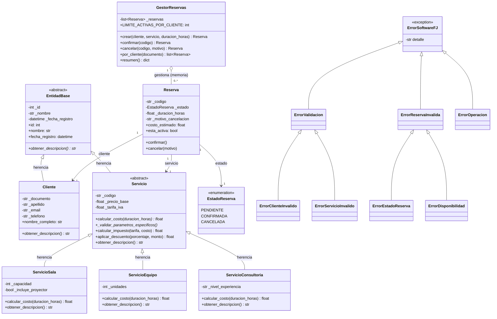
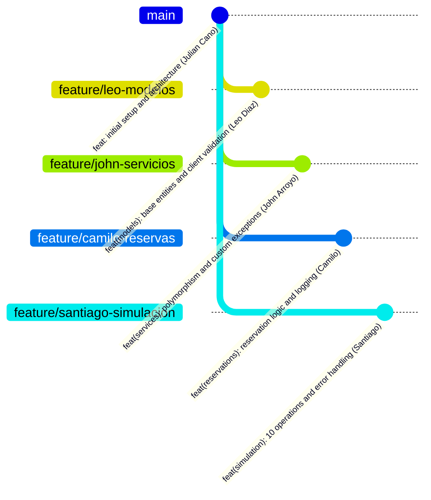

# Programacion_Fase04_213023_466

Object-Oriented Programming (213023) — Group 466
Universidad Nacional Abierta y a Distancia (UNAD)
Phase 4 — Simulated Practices (Practicas Simuladas)

## About the Project

This repository hosts the collaborative project for Phase 4 of the Object-Oriented Programming course. The purpose of this phase is to strengthen object-oriented programming skills through simulated practices, with an emphasis on exception handling, error identification, and the construction of applications that are more stable, secure, and robust.

The project is developed by a team of five students using GitHub as the platform to develop, document, and manage the source code of the assigned problem (Anexo 3 — Problemas a desarrollar Fase 4).

## Objectives

### General Objective

Design and implement an object-oriented application that applies exception-handling mechanisms to identify, control, and manage runtime errors, producing stable, secure, and robust software through collaborative team work.

### Specific Objectives

- Apply object-oriented programming principles (classes, objects, encapsulation, inheritance, and polymorphism) to model the assigned problem.
- Implement exception-handling mechanisms that allow the application to identify, control, and manage errors during execution.
- Identify runtime and logic errors, and apply the necessary corrections to keep the program stable.
- Develop the solution collaboratively, implementing new code or continuing the work of teammates while documenting every line clearly.
- Validate the code by executing each developed segment sequentially and verifying its correct behavior.
- Use GitHub as a collaborative version-control tool for development, documentation, and code management.

## Activity Details

| Item | Description |
|------|-------------|
| Start date | Monday, October 26, 2026 |
| Closing date | Sunday, November 22, 2026 |
| Score | 150 points |
| Modality | Collaborative work — Simulated practice |
| Team size | 5 students |

## Development Guidelines

1. **GitHub repository:** every team member works on the repository assigned to their group.
2. **Collaborative development:** implement code or continue the work started by teammates, documenting each line clearly.
3. **Exception handling:** apply mechanisms to identify, control, and manage errors during application execution.
4. **Code validation:** run the developed segments sequentially, verify their behavior, and apply the necessary corrections.
5. **Active participation:** all team members contribute to the development and coding of the project.

## Deliverables

A PDF document containing:

1. Cover page.
2. Introduction.
3. Link to the project repository on GitHub.
4. Conclusions.
5. Bibliographic references in APA format.

## Team

| Member | GitHub |
|--------|--------|
| Julian Cano | [JulianCanoDev](https://github.com/JulianCanoDev) |
| Team member 2 | — |
| Team member 3 | — |
| Team member 4 | — |
| Team member 5 | — |

## Technologies

- Programming language: Python 3.12+ (standard library only — **no database engine**; all data lives in memory as objects and lists).
- Version control: Git.
- Repository hosting and collaboration: GitHub.
- Containerization (optional): Docker.

## System: Software FJ — Service Reservations

"Software FJ" is an object-oriented application that manages clients, services
(rooms, equipment, consulting) and reservations with strict data validation,
custom exceptions and full event/error logging. The only file I/O performed by
the system is the log file `logs/software_fj.log`.

### Team assignments

| Member | Responsibility | Files |
|--------|----------------|-------|
| Julián Cano | Base setup, containerization and architecture | `Dockerfile`, `requirements.txt`, `README.md` |
| Leo Diaz | Domain model: base entity and client | `models/entidades.py`, `models/cliente.py` |
| John Arroyo | Services (polymorphism) and custom exceptions | `models/servicios.py`, `utils/excepciones.py` |
| Camilo | Reservations and logging | `models/reserva.py`, `utils/logger.py` |
| Santiago | Simulation of 10+ operations with advanced exception handling | `main.py` |

### Project structure

```
.
├── Dockerfile              # Base setup (Julián Cano)
├── requirements.txt        # Base setup (Julián Cano)
├── README.md               # Base setup + UML (Julián Cano)
├── main.py                 # Simulation (Santiago)
├── models/
│   ├── entidades.py        # Abstract base entity (Leo Diaz)
│   ├── cliente.py          # Cliente with strict validation (Leo Diaz)
│   ├── servicios.py        # Servicio hierarchy (John Arroyo)
│   └── reserva.py          # Reserva + GestorReservas (Camilo)
├── utils/
│   ├── excepciones.py      # Custom exception hierarchy (John Arroyo)
│   └── logger.py           # Event/error log configuration (Camilo)
└── logs/
    └── software_fj.log     # Only file I/O allowed (auto-generated)
```

### UML Class Diagram



### Collaborative Git workflow



### How to run

Locally (Python 3.12+):

```bash
python main.py
```

With Docker:

```bash
docker build -t software-fj .
docker run --rm software-fj
```

The simulation executes 21 operations (valid and invalid clients, correct and
incorrect services, successful and failed reservations) using `try/except`,
`try/except/else`, `try/except/finally` and exception chaining. The application
never crashes: every failure is caught, logged to `logs/software_fj.log` and the
next operation continues.
